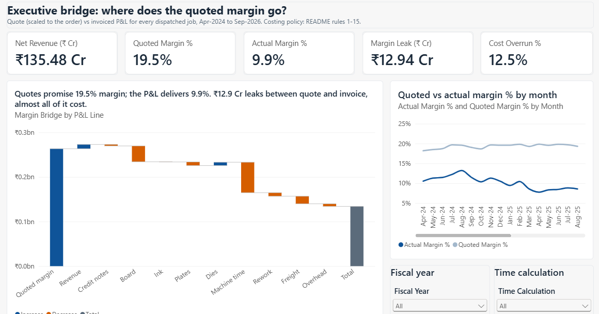
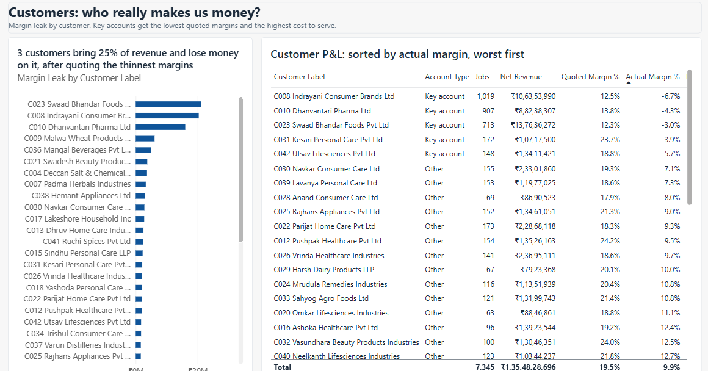
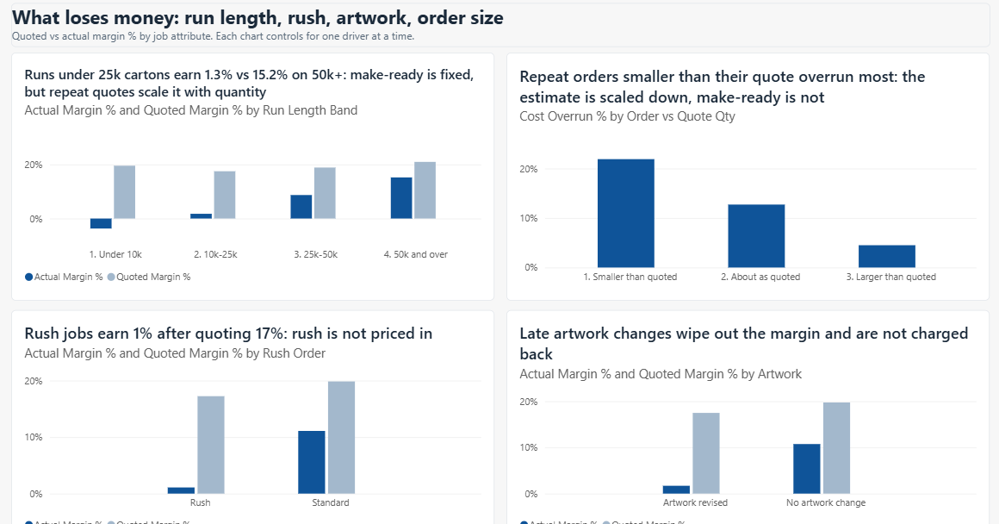

# Margin Leakage Intelligence

**A quote-vs-actual margin model for a make-to-order manufacturer. It finds where the missing margin goes, down to the job, customer, machine and estimator, and it reconciles to the rupee.**

Power BI (PBIP / TMDL / PBIR) · PostgreSQL · Power Query (M) · DAX · Tabular Editor · GitHub Actions



## The question

Conquer Cartons (a fictional folding-carton converter in Pune) quotes every job carefully, yet the P&L margin is far below what the quotes promise. Management asked: *why, and which customers, products and decisions are causing it?*

**Answer: the quotes promise 19.5% margin and the P&L delivers 9.9%. ₹12.9 Cr leaks between quote and invoice over 30 months (about ₹5.2 Cr a year), and almost all of it is cost, not price.** Revenue actually came in ₹0.6 Cr above quote.

## Findings

| # | Finding | ₹ impact (Apr-2024 to Sep-2026) | Recommendation |
|---|---|---|---|
| 1 | **Three key accounts lose money.** C008 Indrayani, C010 Dhanvantari and C023 Swaad Bhandar bring 25% of revenue (₹33.2 Cr) at **−4.6%** actual margin, after being quoted the thinnest margins (12.8% vs 21.7% for everyone else). They order short runs (avg 25.5k cartons vs 43k), 25% of their jobs are rush, deliveries average 3.9 drops (vs 1.4), and C023 pays in 122 days on 45-day terms. | ₹5.74 Cr of the ₹12.94 Cr leak (44%); freight alone ₹1.31 Cr over quote; C023 financing cost ₹56 L | Re-price at renewal: per-drop delivery charge, rush surcharge, minimum order quantity. Enforce C023's payment terms. |
| 2 | **Make-ready is quoted as if it scaled with quantity.** Runs under 25k cartons earn 1.3% vs 15.2% on runs of 50k+. Repeat orders reuse an old quote scaled to the new quantity, so an order smaller than its quote has its fixed make-ready cut too: those jobs overrun by 22%. Machine time is the largest overrun of any cost element. | ₹5.24 Cr overrun on 3,253 short-run jobs; machine time ₹6.83 Cr over estimate in total | Quote make-ready as a fixed charge per job. Re-quote repeat orders whose quantity differs from the quote by more than 20%. Add a short-run surcharge. |
| 3 | **One estimator under-quotes machine time.** EST03 prices 46% of jobs and overruns by 16.1% (others 7–11%), on the same customers as everyone else, so it is not mix. EST03's press make-ready runs 18% over estimate while the other estimators' run at or below estimate. | ₹7.54 Cr of the ₹13.56 Cr cost overrun is on EST03's jobs | Recalibrate EST03's make-ready standards; peer-review EST03 quotes above a value threshold. |

Supporting findings:
- **Board is a waste problem, not a price problem:** usage variance ₹3.19 Cr vs price variance ₹0.35 Cr (of which stale quote prices ₹0.33 Cr, buying ₹0.02 Cr). Jobs use 5.2% more board than estimated.
- **Rush jobs earn 1.1%** after quoting 17.2%; jobs with late artwork changes earn 1.7%.
- **₹76.5 L of rework was caused by customers** (late artwork changes, QA rejections on text/barcode) and was not charged back.
- **The headline win rate (60%) is flattering:** re-quotes of repeat orders are always won. The new-business win rate is 16.6%.
- **₹25.3 L of machine time (572 h) has no job** (maintenance in the old MES): reported as unabsorbed capacity, never charged to jobs.

The findings overlap (the three key accounts order more short runs and rush jobs, and many of their quotes are by EST03), so the rupee impacts are not additive.

## Report

| Page | Question it answers |
|---|---|
| 1 Executive bridge | How much margin leaks from quote to P&L, and at which line? |
| 2 Customers | Who really makes us money? |
| 3 What loses money | Run length, order size vs quote, rush and artwork changes |
| 4 Estimating | Does the estimator matter? How competitive are we on new business? |
| 5 Shop floor | Planned vs actual hours, make-ready share, stoppage Pareto, unabsorbed time |
| 6 Materials | Board usage vs planning-price vs purchase-price variance |
| 7 Plan vs actual | Revenue and margin vs budget by segment, year to date |
| 8 Cost to serve | Days to pay, financing cost (what-if rate), freight overrun, customer-caused rework |
| 9 Data quality & reconciliation | 55 validation checks and the control totals |

Every chart title is a finding, and the key titles are DAX measures that update with the filters. The theme uses one colour-blind-safe accent (orange) for "bad", and every visual has alt text.




## Architecture

```
PostgreSQL 18 (raw → erp / finance / masters)  ─┐
MES CSV exports (30 files, two schemas)          ├─► Power Query ─► star schema (TMDL) ─► DAX ─► report (PBIR)
Stores CSVs, QA / budget / rate-card Excel      ─┘   stg_ → fn → Dim / Fact          80 measures   9 pages
                                                     05 Validation (55 checks)        calc group
```

- **SQL layer** (`sql/`): raw landing as TEXT, a typed layer that only casts, a 100-check profiling scorecard and an independent reconciliation script with control totals.
- **Power Query**: 9 reusable functions (`fnNormaliseJobNo`, `fnConformMesV1/V2`, `fnAddEffectiveValue`, `fnMapCustomerCode`, …), reference files in `reference/` for business mappings, and validation queries that must return 0.
- **Model**: `Fact Job PL` at job × P&L line (estimate and actual side by side, so the bridge closes by construction), plus Machine Log, Job Machine (planned vs actual hours), Board Variance, Rework, Quote, Invoice Payment and Budget facts. One-to-many, single-direction relationships; invoice date active, order date inactive; Dim Date covers whole Indian financial years.
- **DAX**: 80 measures in numbered display folders, each with a description. Margin bridge, three-way board variance, win rates with re-quotes separated out, cost of capital with a what-if rate, a time-intelligence calculation group (FYTD, PY FYTD, YoY) that never compares a partial year with a full one, and dynamic finding titles.
- **Security**: dynamic RLS role `Sales Rep` on the rep's sign-in e-mail.

## Data honesty

- The company, people and numbers are **synthetic**, generated by a simulation with AI assistance and calibrated to public Indian industry figures where they exist (see the dataset README). The data was built with deliberate problems:
  - three customers with legacy duplicate codes
  - three job-number formats
  - an MES upgrade that changed columns, units and labels
  - re-sent MES rows
  - free-text ink names
  - title rows in Excel
  - jobs keyed without a quote
  - missing FX days
- Every fix is a documented, reusable rule with a validation check. No source value was edited by hand. See `docs/decisions.md`.
- 406 jobs (5.5%) had no quote reference and were linked to a quote by rule. They are flagged on Dim Job, and their margins match the keyed jobs.

## Proving it

- **Control totals**: net revenue ₹1,35,48,28,696.27 ties to the SQL reconciliation (`sql/04_reconciliation.sql`) to the paisa. The whole costing policy was also re-implemented in T-SQL, separately from Power Query. Net revenue, credit notes and actual cost match it exactly, and estimated cost is within ₹154 (estimate rounding). See `tests/control_totals.dax`.
- **Bridge check**: the margin bridge's steps add up to the actual margin (difference ₹0).
- **Data quality**: 55 of 55 Power Query checks pass, shown on page 9.
- **RLS**: `tests/rls_row_counts.dax` checks that the sales reps' slices add back to the company total.
- **Best Practice Analyzer**: `tests/bpa_rules.json` encodes the project's standards (descriptions, display folders, DIVIDE, hidden keys, single-direction one-to-many relationships, marked date table, no implicit measures). It runs in GitHub Actions on every model change (`.github/workflows/model-quality.yml`). 0 violations.

## How this was built

I planned this project and built it with Claude (Anthropic) as a mentor and pair programmer. Claude explained each concept, reviewed my work and, at my request, wrote much of the SQL, Power Query, model, DAX and report from the plan and the decisions recorded in `docs/decisions.md`. I ran every step, checked the outputs and can explain each design choice. The numbers were verified against an independent SQL implementation of the costing policy.

## How to run

1. Install PostgreSQL, create database `conquer`, and run `sql/00_setup.sql` → `01_raw_landing.sql` → `02_typed_layer.sql` (set the data path at the top of 01).
2. Optional checks: `03_profiling.sql` (scorecard) and `04_reconciliation.sql` (control totals).
3. Open `MarginLeakage.pbip` in Power BI Desktop. Set the parameters `DataFolder`, `RepoFolder`, `DbServer` and `DbName`, then refresh. Privacy level: Organizational for both PostgreSQL and the files.
4. Optional tests: with the report open, run `powershell -ExecutionPolicy Bypass -File tests\run_dax_tests.ps1` (needs DAX Studio installed).

## Repo map

```
sql/                       PostgreSQL: setup, raw landing, typed layer, profiling, reconciliation
reference/                 business mapping files read by Power Query (customer codes, ink names, cost elements, segments)
MarginLeakage.SemanticModel/  TMDL: Power Query, tables, relationships, measures, calc group, RLS role
MarginLeakage.Report/      PBIR: 9 pages, theme
tests/                     DAX tests, BPA rules, test runner
docs/                      decision log, case study, reconciliation notes, screenshots
```
